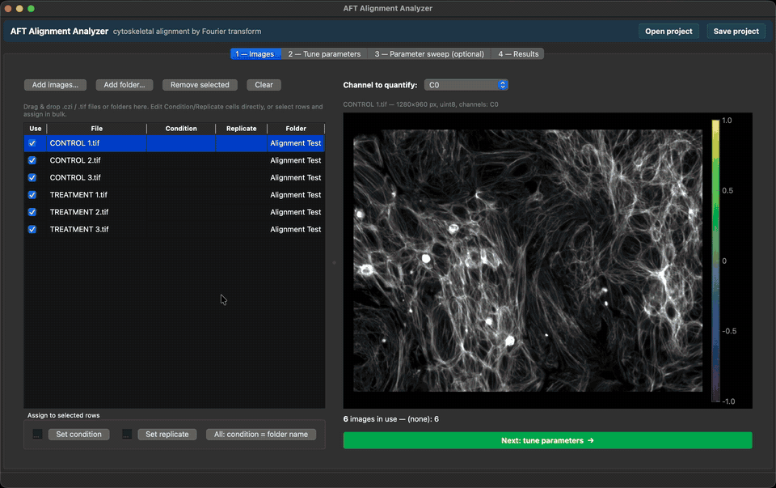

<p align="center"></p>

# AFT Alignment Analyzer

[](https://github.com/joacosmucler/AFT-Alignment-Analyzer/actions/workflows/tests.yml)
[](https://github.com/joacosmucler/AFT-Alignment-Analyzer/releases/latest)
[](LICENSE)


<p align="center">
  <a href="https://github.com/joacosmucler/AFT-Alignment-Analyzer/releases/latest/download/AFTAnalyzer-windows.zip"></a>
  &nbsp;
  <a href="https://github.com/joacosmucler/AFT-Alignment-Analyzer/releases/latest/download/AFTAnalyzer-macos-arm64.zip"></a>
</p>
<p align="center"><sub>No Python needed. First time opening it? See <a href="#download-no-python-needed">how to run</a>.</sub></p>

Desktop app for measuring cytoskeletal alignment with **AFT (Alignment by
Fourier Transform)**
([OakesLab](https://github.com/OakesLab/AFT-Alignment_by_Fourier_Transform);
Marcotti et al., *Front. Comput. Sci.* 2021,
[doi:10.3389/fcomp.2021.745831](https://doi.org/10.3389/fcomp.2021.745831)).

You load CZI or TIFF images and assign each one a condition. You then tune the
parameters live or with a parameter sweep. The app gives you the order
parameter for each condition with statistics, plus the alignment map inside
each image.

**Why a GUI?** The original AFT is a set of Python functions and notebooks.
This app wraps a validated, vectorized version of it (numerically identical to
the original, see [tests](tests/test_core.py)) in a point-and-click workflow:
no code, live parameter tuning, a guided parameter sweep that warns about
unreliable and circular choices, and publication-ready plots and statistics.

<!-- Demo video / GIF goes here, e.g.:

-->

---

## Download (no Python needed)

### Windows 10/11 (64-bit)

1. Download **[AFTAnalyzer-windows.zip](https://github.com/joacosmucler/AFT-Alignment-Analyzer/releases/latest/download/AFTAnalyzer-windows.zip)** (155 MB).
2. Right-click the zip → **Extract All…** Don't run the app from inside the
   zip: it won't start.
3. Open the extracted `AFTAnalyzer` folder and double-click **`AFTAnalyzer.exe`**.
4. The first time, Windows SmartScreen may say it protected your PC. Click
   **More info → Run anyway**. The app is not code-signed, so this is
   expected.

### macOS (Apple Silicon: M1, M2, M3, M4…)

Not sure which chip you have? Open  → **About This Mac**. If it says
*Chip: Apple M…*, this build is for you. Intel Macs are not supported yet;
use [Install from source](#install-from-source) instead.

1. Download **[AFTAnalyzer-macos-arm64.zip](https://github.com/joacosmucler/AFT-Alignment-Analyzer/releases/latest/download/AFTAnalyzer-macos-arm64.zip)** (120 MB).
2. Double-click the zip to unzip it, then drag **`AFTAnalyzer.app`** into
   *Applications*.
3. Double-click the app. The first time, macOS blocks it because it is not
   signed by an identified developer. Click **Done** (not *Move to Trash*).
4. Open **System Settings → Privacy & Security**, scroll down to the message
   about *AFTAnalyzer*, and click **Open Anyway**. Confirm with your password.
   You only have to do this once.

All versions are on the [Releases](https://github.com/joacosmucler/AFT-Alignment-Analyzer/releases/latest)
page. To build the app yourself, see
[Building the executables](#building-the-executables).

## Install from source

```bash
conda create -n aft python=3.12 -y
conda activate aft
pip install -e .
aft-gui                     # or: python -m aft_gui
```

---

## Workflow

| Tab | What you do |
|---|---|
| **1 · Images** | Add `.czi` or `.tif` files or folders. Drag & drop also works. Choose the **channel** to quantify. Z-stacks are max-projected. Give each image a **Condition**: edit the cell, assign it to the selected rows, or click *All: condition = folder name*. **Replicate** is optional (for example, the differentiation batch). |
| **2 · Tune parameters** | Sliders for window size, overlap, neighbourhood radius, and the intensity and eccentricity thresholds. They start at the paper defaults: window 65 px, overlap 0.5, neighbourhood 5. Image **A** shows the orientation vectors and a map you can switch (local order, orientation or eccentricity). Image **B** is optional: load a sample you expect to look different, to check that the parameters separate the two. |
| **3 · Parameter sweep** *(optional)* | Runs the same search as `AFT_tools.parameter_search`: every combination of window size and neighbourhood radius. It shows the **A − B difference**, the **Mann-Whitney p-value**, or the median order parameter of one condition. Less reliable cells are marked ×. A ★ marks a suggestion. Nothing is applied until you click a cell and confirm. |
| **4 · Results** | Analyses all images. Plots the order parameter by condition as bar, box, violin or points, with one point per image or one per replicate mean. Shows Kruskal-Wallis and pairwise Mann-Whitney / Welch tests. Click an image to see its internal alignment map. |

### Choosing parameters

The sweep tab includes a short guide. In brief:

- **Judge by the difference between conditions, not by the highest value.**
  The order parameter always gets higher with small windows and radius 1, in
  every sample. That brightest corner is mostly noise: the FFT of a small
  window is nearly circular (see the paper).
- **Cells marked ×** have one of two problems:
  - Fewer than *Min windows* windows per image contribute, so the median is
    unstable.
  - More than half of the neighbours share pixels with the centre window.
    Their orientations then agree partly by construction. For example,
    overlap 0.5 with radius 1, or overlap 0.3 with radius ≤ 3.
- **Prefer a stable plateau** over an isolated peak. Choose a window that
  holds several fibres, and check the vectors in tab 2. The paper finds the
  optimal length scale near cell size.
- **Avoid circular selection.** If you pick the parameters that best separate
  the same images you will test, the significance is inflated. Tune on a pilot
  subset or a different replicate, fix the parameters, then analyse everything
  and report the parameters you used.

### Export

**Results → Export results…** writes these files:

| File | Contents |
|---|---|
| `aft_per_image.csv` | One row per image, with the parameters used |
| `aft_per_condition.csv` | Count, mean, SD and median for each condition |
| `aft_per_window.csv` | x, y, orientation, eccentricity and local order for every window |
| `aft_parameters.json`, `aft_stats.txt` | Parameters and statistics |
| `order_parameter.png` / `.svg` | The plot (PNG at 300 dpi) |

**Save project** (Ctrl+S) saves the image list, conditions, channel and
parameters to an `.aft.json` file.

---

## Building the executables

PyInstaller can't cross-compile, so each platform has to be built on that platform.

**On GitHub (both platforms):** push the repository, then go to **Actions →
Build executables → Run workflow**. Pushing a tag such as `v0.2.0` does the
same and attaches the zips to a Release. Each job runs the tests, builds the
app, checks the frozen binary with `--selftest` and makes sure the GUI starts.

**Locally** (Windows → `.exe` folder, macOS → `.app`):

```bash
pip install -r packaging/requirements-build.txt
pyinstaller packaging/AFTAnalyzer.spec --noconfirm
dist/AFTAnalyzer.app/Contents/MacOS/AFTAnalyzer --selftest   # macOS check
```

To regenerate the icons: `python packaging/make_icon.py`.

## Repository layout

```
aft_gui/
  core.py          vectorized AFT (orientation field, local order map, sweep)
  imageio.py       CZI / TIFF reading → 2D plane per channel
  common.py        project state, worker thread, image + map viewer
  app.py           main window
  tab_data.py      1 · images, channels, conditions
  tab_tune.py      2 · interactive tuning
  tab_sweep.py     3 · parameter sweep
  tab_results.py   4 · batch analysis, plot, stats, export
packaging/         PyInstaller spec, build requirements, icons
tests/             equivalence tests against the original AFT_tools (tests/reference)
.github/workflows/ tests on every push; Windows + macOS builds on tags
```

## Implementation notes

- `aft_gui/core.py` is a vectorized rewrite of `AFT_tools.image_local_order`
  and `calculate_order_parameter`. It processes windows in batches and in
  chunks, so memory stays bounded. It reproduces the original's orientation,
  eccentricity and order parameter to 1e-9 (`pytest tests`) and also returns
  the order parameter of every window.
- *Overlap* uses the AFT convention: windows are `window_size × overlap`
  apart, so a smaller value gives a denser grid.
- Windows closer to the image edge than the neighbourhood radius get no local
  order value. This matches the original.

## License

MIT. The algorithm and the reference implementation are © OakesLab (MIT).
Please cite Marcotti et al. 2021 when you use this tool.
